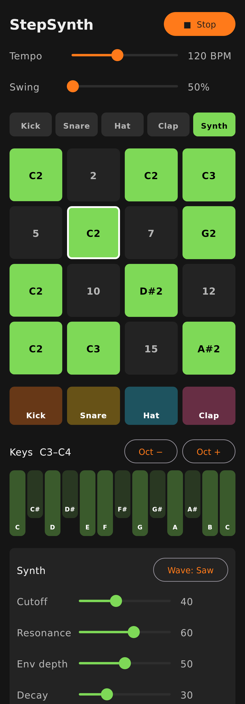

# StepSynth

A pocket synthesizer and drum machine for Android: a 16-step sequencer driving four synthesized drums and a monophonic synth.



*(Preview rendered on a computer with a fake audio engine. It will look slightly different on a phone.)*

## What it does so far

- **Sequencer:** 16 steps in a 4x4 grid, 5 tracks (Kick, Snare, Hat, Clap, Synth), tempo 60-200 BPM, and swing
- **Drum pads:** tap to play the drums live
- **Synth keyboard:** one octave at a time, with octave up/down
- **Synth sound:** saw or square wave, filter cutoff, resonance, envelope depth, decay
- A demo beat and bassline are loaded when the app starts, so you hear something right away

**Entering synth notes:** play a key (this selects the Synth track and remembers the note), then tap an empty step to place that note there. Tap a lit step to clear it.

## Running it on your phone

### 1. Install Android Studio
Download it from <https://developer.android.com/studio> and install it with the default options. The first launch downloads the Android SDK, which takes a while.

### 2. Get this code onto your computer
The easiest way is **GitHub Desktop** (<https://desktop.github.com>): sign in, clone `Kiltreiser/hello-world`, then switch to the branch `claude/android-portable-synthesizer-8jyk8u` using the "Current branch" menu.

### 3. Open the project
In Android Studio choose **File > Open** and select the **`StepSynth`** folder. Pick that folder itself, not the `hello-world` folder above it.

Android Studio will then "sync" the project. The first sync downloads Gradle, the Android NDK (for the C++ code) and all the libraries, so it can take 10+ minutes. If it asks to install a missing NDK or CMake, say yes. If it offers to upgrade the Android Gradle Plugin, that's optional.

### 4. Prepare your phone
1. Open **Settings > About phone** and tap **Build number** seven times. This unlocks "Developer options".
2. In **Settings > System > Developer options**, turn on **USB debugging**. The exact location varies by phone brand.
3. Connect the phone with a USB cable that carries data (some cables only charge) and accept the "Allow USB debugging?" prompt on the phone.

### 5. Run
Your phone should appear in the device dropdown at the top of Android Studio. Press the green **Run** button (▶).

**Use wired headphones or the phone speaker.** Bluetooth headphones add a delay of roughly 0.1-0.2 seconds, which makes any instrument feel broken.

## How the code is organized

```
app/src/main/
├── cpp/                      C++: everything that makes sound
│   ├── engine/
│   │   ├── AudioEngine.*     Sequencer clock + mixer. Start reading here.
│   │   ├── SynthVoice.h      The synth: oscillator -> filter -> amplifier
│   │   ├── DrumVoices.h      Kick, snare, hat and clap, made from sine waves and noise
│   │   ├── Dsp.h             Building blocks: filter, envelope, noise
│   │   └── SpscQueue.h       Passes "play this now" messages to the audio thread
│   ├── OboePlayer.*          Connects the engine to the phone's speaker (Oboe library)
│   └── jni_bridge.cpp        Lets Kotlin call the C++ functions
└── java/com/kiltreiser/stepsynth/   Kotlin: everything you see and touch
    ├── MainActivity.kt       App entry point, starts/stops audio
    ├── StepSynthViewModel.kt Holds the pattern and settings, sends changes to the engine
    ├── audio/NativeEngine.kt The list of C++ functions Kotlin can call
    └── ui/                   The screen (Jetpack Compose) and colors
```

**Why two languages?** Kotlin is the normal language for Android apps and is good for the UI. Audio has to be produced every few milliseconds without a single pause, and Kotlin's automatic memory cleanup (garbage collection) can pause at any moment and cause clicks. So the sound is made in C++, and Kotlin only tells it what to do.

**Why does the sequencer live in C++?** It counts audio samples (48,000 per second) to decide exactly when each step plays. A timer in the UI code would drift and wobble.

## Testing the audio engine on a computer

`engine-tests/render_test.cpp` checks the sequencer timing and audio levels without a phone, and writes `demo.wav` so you can listen to it. With a C++ compiler installed (on Linux or macOS, or WSL on Windows), run from the `StepSynth` folder:

```
g++ -std=c++17 -O2 -I app/src/main/cpp/engine engine-tests/render_test.cpp app/src/main/cpp/engine/AudioEngine.cpp -o render_test
./render_test
```

## Good first changes to try yourself

- Change the track colors in `ui/Theme.kt`
- Change the demo pattern in `loadDemoPattern()` in `StepSynthViewModel.kt`
- Widen the tempo range in `TransportSection` in `ui/StepSynthScreen.kt`
- Make the kick longer or shorter: `decayCoef(0.2f, sr)` in `Kick` in `DrumVoices.h`

## Planned next steps

Parameter locks (per-step sound settings), pattern chaining, live recording, sampling from the microphone, saving and loading patterns.
