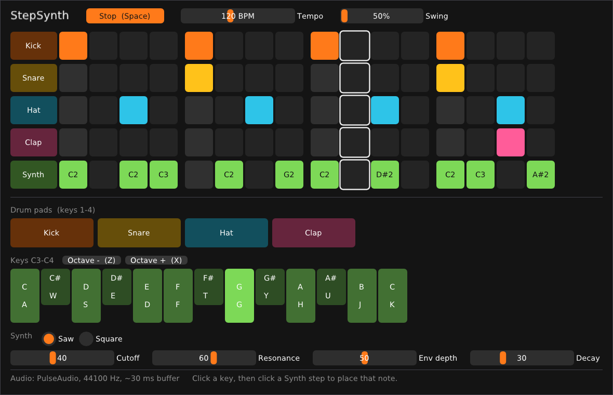

# StepSynth for Linux

The Linux desktop version of [StepSynth](../StepSynth/): a 16-step sequencer with four drums and a synth. It uses **the same audio engine** as the Android app (`StepSynth/app/src/main/cpp/engine/`), so both apps sound the same, and a fix to the engine fixes both.



Built and tested on Ubuntu 24.04, which Linux Mint 22 is based on.

## Build and run on Linux Mint

### 1. Install the tools (once)

Open a terminal and run:

```
sudo apt install build-essential cmake git libsdl2-dev
```

- `build-essential`: the C++ compiler
- `cmake`: the build tool that reads `CMakeLists.txt`
- `git`: needed because the first build downloads two small libraries from GitHub
- `libsdl2-dev`: for the window, mouse and keyboard

### 2. Build

In a terminal, go to this folder (for example `cd ~/hello-world/StepSynthDesktop`) and run:

```
cmake -S . -B build
cmake --build build -j
```

The first command sets up the build and downloads Dear ImGui and miniaudio, and the second compiles everything. The first build takes a minute; after that, only changed files are rebuilt.

### 3. Run

```
./build/stepsynth
```

After changing any code, run `cmake --build build -j` again, then restart the app.

## Controls

| Action | Mouse | Keyboard |
|---|---|---|
| Play / stop | Play button | Space |
| Turn a step on or off | Click a grid cell | |
| Play drums | Click a pad or a track name | 1, 2, 3, 4 |
| Play synth notes | Click the keys | A W S E D F T G Y H U J K (laid out like a piano) |
| Octave down / up | Octave buttons | Z / X |
| Place a synth note | Play a key, then click an empty Synth step | |
| Change a synth step's note | Scroll the mouse wheel over it | |
| Type an exact value | Ctrl+click a slider | |

## If the sound crackles or feels delayed

The bottom of the window shows the audio setup, for example `PulseAudio, 48000 Hz, ~30 ms buffer`. The buffer is the delay between pressing a key and hearing it.

- **Crackles or dropouts:** use a bigger buffer. `STEPSYNTH_BUFFER_MS=20 ./build/stepsynth`
- **Feels laggy:** try a smaller one. `STEPSYNTH_BUFFER_MS=5 ./build/stepsynth` Too small and it will crackle; how small works depends on your computer.

The default is 10 (three 10 ms chunks, about 30 ms in total).

If the bottom line is red and says no sound device was found, check that sound works in other apps and that the right output is selected in Mint's Sound settings, then restart StepSynth.

## How the code is organized

```
StepSynthDesktop/
├── CMakeLists.txt       Build instructions: which files and libraries make up the app
└── src/
    ├── main.cpp         Opens the window, starts audio, redraws ~60 times a second
    ├── StepSynthUi.*    Everything on screen, plus the computer-keyboard controls
    └── AudioOutput.*    Sends the engine's sound to your speakers (miniaudio)

../StepSynth/app/src/main/cpp/engine/   The shared sequencer, synth and drums
```

`StepSynthUi` does the job that `StepSynthViewModel` and `StepSynthScreen` do on Android: it keeps a copy of the pattern for drawing, and passes each change on to the engine.

The UI uses [Dear ImGui](https://github.com/ocornut/imgui), which redraws the whole window every frame from plain C++ code. For example, `if (ImGui::Button("Play")) togglePlaying();` both draws the button and handles the click.

## Good first changes to try

- Swap the computer-keyboard layout in `kPianoComputerKeys` in `src/StepSynthUi.cpp`
- Change the window's starting size in `SDL_CreateWindow` in `src/main.cpp`
- Change the colors in `kTrackColors` in `src/StepSynthUi.cpp`
